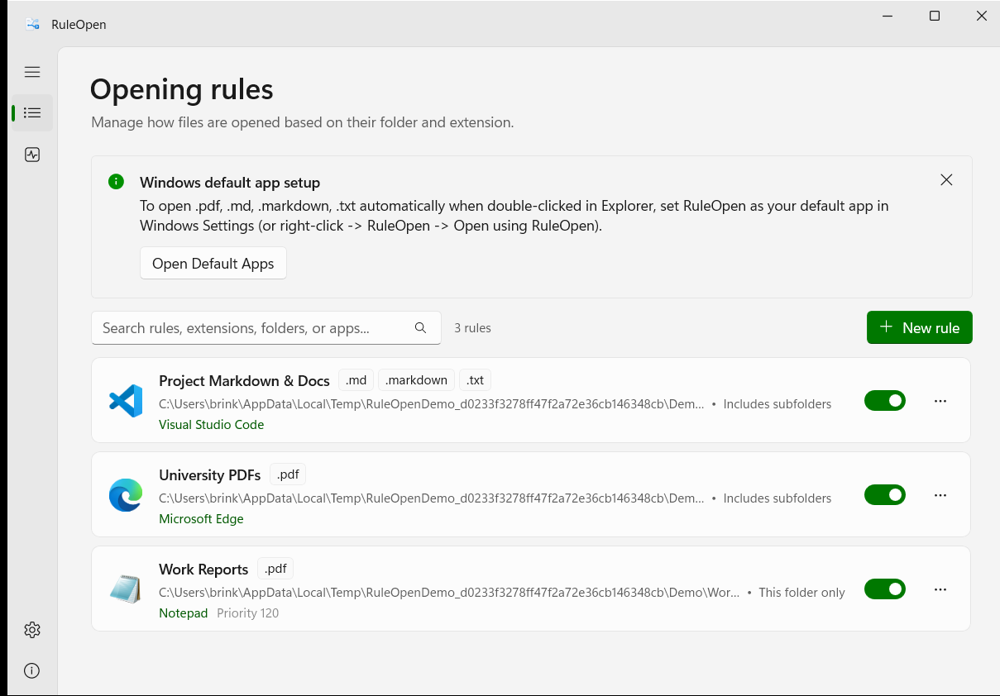
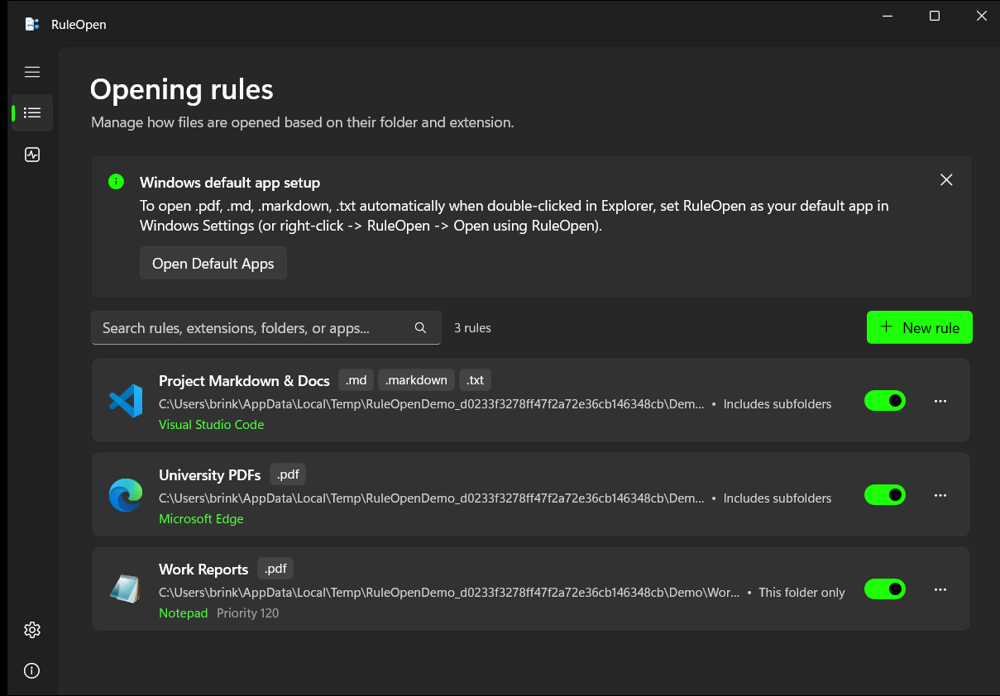
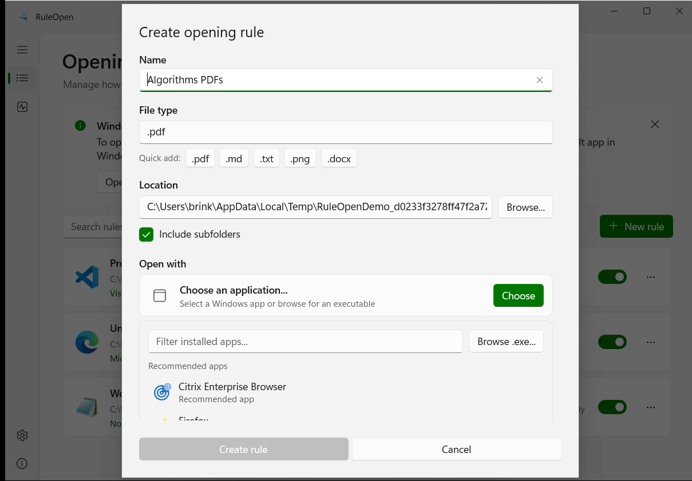
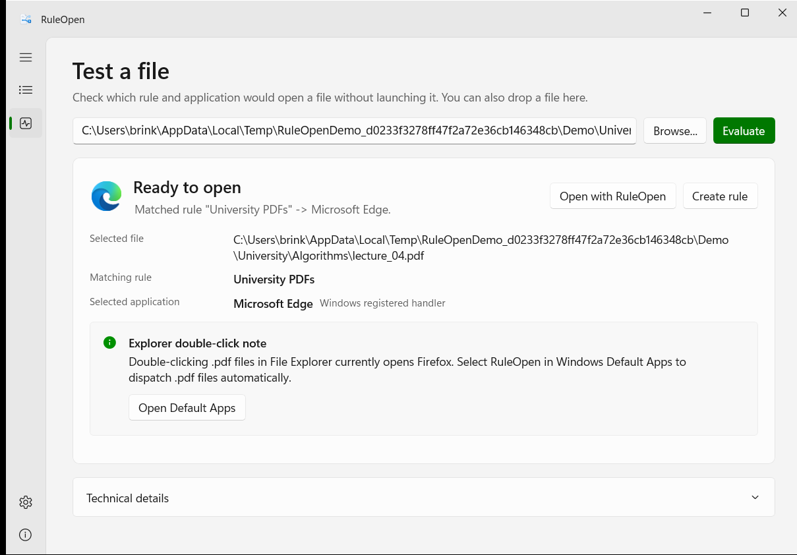
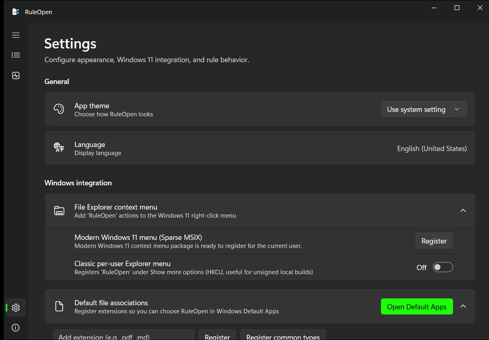

<div align="center">
  

  <h1>RuleOpen</h1>

  <p>
    <strong>Context-aware file opening rules for Windows 11. Configure once. Open naturally.</strong>
  </p>

  <p>
    <a href="https://apps.microsoft.com/detail/9NPTZJ83X1W9"></a>
    
    
    
    
    <a href="LICENSE"></a>
  </p>

  <p>
    <a href="https://apps.microsoft.com/detail/9NPTZJ83X1W9"><strong>Get RuleOpen on the Microsoft Store</strong></a> ·
    <a href="https://github.com/Paul1708/RuleOpen/releases">GitHub Releases (MSI &amp; Portable ZIP)</a>
  </p>
</div>

---

## Overview

Windows associates each file extension with a single default application. **RuleOpen** extends this model cleanly by choosing which application opens a file based on **both its folder location and file type**—without getting in your way during everyday work.

Double-click a `.pdf` in `D:\University\` and it opens in **Adobe Acrobat**; double-click a `.pdf` in `D:\Work\` and it opens in **Microsoft Edge**; double-click a `.md` in `D:\Projects\` and it opens in **Visual Studio Code**.

All normal file activations run through a lightweight, zero-WinUI dispatcher (`RuleOpen.Dispatcher.exe`, ~29 MB peak memory) that evaluates your rules in under a millisecond, launches the selected application directly, and exits immediately—no splash screens, background daemons, or intermediate popups.

---

## Key Features

- **Folder & Extension Rules**: Match single or multiple extensions (`.md, .markdown, .txt`) case-insensitively with optional subfolder recursion and exact-boundary path matching.
- **Deterministic Precedence Engine**: Deeper, more specific folders automatically take precedence over broader parent directories (or configure explicit priority-first mode), completely independent of rule order.
- **Native Windows 11 Fluent UI**: Built with WinUI 3, Windows App SDK, Mica backdrop, native Light/Dark themes, Windows system accent colors, and `SettingsCard` layouts matching Windows Settings.
- **Dynamic Routed Explorer Icons**: Choose between displaying **the routed target app's icon per folder** via RuleOpen's native C++20 `IExtractIconW` shell handler (default), **10-frame high-DPI RuleOpen extension badge icons** (`16–256 px`), or **inheriting the extension's fallback app icon**.
- **Real Windows Application Discovery**: Enumerates compatible Win32 and Microsoft Store/MSIX handlers via `SHAssocEnumHandlers` with real extracted application icons, plus custom `.exe` browsing.
- **Editable Fallback Applications**: Auto-captures each extension's prior default handler as a fallback and lets you customize both per-extension and global fallbacks at any time.
- **File Explorer Context Menu**: Includes both a native C++20 `IExplorerCommand` integration for the modern Windows 11 menu (automatic when installed via Store MSIX, or optional Sparse MSIX package for desktop builds) and a classic per-user menu toggle.
- **Respectful Default Handler Integration**: Registers per-extension capabilities (`RuleOpen.File.<ext>`) under `HKCU\Software\RegisteredApplications`, detects Windows 11 `UserChoiceLatest` defaults accurately, and links directly to Windows Default Apps—never tampering with protected `UserChoice` keys.
- **Rule Testing & Diagnostics**: Preview exactly which rule and application will open any file (with drag-and-drop and full precedence reasoning) before opening it.
- **100% Offline & Private**: Zero telemetry, zero analytics, zero background services, and atomic JSON configuration stored in `%LocalAppData%\RuleOpen\config.json` (see [`PRIVACY.md`](PRIVACY.md)).

---

## Screenshots

### Opening Rules (Light & Dark Mode)

<p align="center">
  
  
</p>

### Rule Creation & Diagnostics

<p align="center">
  
  
</p>

### Windows Integration Settings

<p align="center">
  
</p>

---

## Windows Compatibility

- **Primary target**: Windows 11 (21H2 / 22H2 / 23H2 / 24H2 / 25H2, x64)
- **Minimum OS build**: Windows 10 version 2004 (`10.0.19041.0`) or newer
- **Privileges**: Standard user (`asInvoker`) — administrator rights are **not** required for installation, configuration, or daily file opening.

---

## Installation

### Option 1: Microsoft Store (Recommended)
1. Install directly from the **[Microsoft Store](https://apps.microsoft.com/detail/9NPTZJ83X1W9)** (`Product ID: 9NPTZJ83X1W9`).
2. Automatically registers the native Windows 11 right-click menu (`IExplorerCommand`), 75+ common file types in Windows Default Apps (`uap3:FileTypeAssociation`), and dynamic per-folder Explorer icons (`desktop10:IconHandler`) with automatic Store updates and zero Developer Mode setup.

### Option 2: Per-User Windows Installer (`.msi`)
1. Download `RuleOpen-1.0.1-win-x64.msi` from [GitHub Releases](https://github.com/Paul1708/RuleOpen/releases).
2. Run the installer — it installs cleanly into `%LocalAppData%\Programs\RuleOpen\` with a Start Menu shortcut, supports in-place upgrades, allows dynamically registering arbitrary custom file extensions in Windows Default Apps, and prompts on completion to launch RuleOpen.
3. Uninstalling from Windows **Settings → Apps → Installed apps** asks whether to delete `%LocalAppData%\RuleOpen\` user data, cleans up RuleOpen's per-user capabilities and Explorer integrations, and offers to open Windows Default Apps if any extensions are still assigned to RuleOpen.

### Option 3: Portable Archive (`.zip`)
1. Download `RuleOpen-1.0.1-win-x64-portable.zip` from [GitHub Releases](https://github.com/Paul1708/RuleOpen/releases) and extract it to any user-writable folder.
2. Run `RuleOpen.Desktop.exe`.

---

## Getting Started

1. **Create your first rule**: Launch **RuleOpen** and click **New rule** (or right-click a file/folder in File Explorer).
2. **Choose scope and app**: Pick your folder, file extension(s), and target application.
3. **Choose how to invoke RuleOpen**:
   - **Context menu workflow**: Right-click any file → **RuleOpen → Open using RuleOpen** (works immediately without changing any Windows default).
   - **Double-click workflow**: Go to **Settings → Default file associations**, ensure the extension is registered, click **Open Default Apps**, and set **RuleOpen** as the default handler in Windows Settings.

---

## Example Rules

| Rule Name | Extensions | Folder Scope | Subfolders | Target Application |
| --- | --- | --- | --- | --- |
| **University PDFs** | `.pdf` | `D:\University\` | Yes | Adobe Acrobat |
| **Work Reports** | `.pdf` | `D:\Work\` | Yes | Microsoft Edge |
| **Project Docs** | `.md, .markdown, .txt` | `D:\Projects\` | Yes | Visual Studio Code |

If you also add a more specific rule for `D:\Projects\ClientA\` (`*.txt` → Notepad), files inside `D:\Projects\ClientA\` automatically match the more specific rule regardless of rule creation order. See [`docs/rule-precedence.md`](docs/rule-precedence.md) for the complete resolution specification.

---

## How Windows Integration Works

RuleOpen follows Microsoft's supported Windows 11 extension points rather than shell hacks:

1. **Per-Extension File Capabilities (`HKCU\Software\RegisteredApplications`)**: Registering an extension creates `RuleOpen.File.<ext>` under `HKCU\Software\Classes` and adds it to `HKCU\Software\RuleOpen\Capabilities\FileAssociations` and `OpenWithProgids`, pointing `shell\open\command` to `RuleOpen.Dispatcher.exe` (or the `WindowsApps` execution alias when installed from the Store). Windows requires explicit user confirmation in **Default Apps** to switch defaults (`UserChoiceLatest` / `UserChoice`).
2. **Dynamic Explorer File Icons (`IExtractIconW` + 10-Frame High-DPI Badges)**: In **Use matched routed app icon** mode (default), File Explorer queries `RuleOpen.ShellExtension.dll` (`CLSID_RuleOpenIconHandler`) against an atomic lookup table (`icon-routes.tsv`) so each `.pdf` displays the icon of the app its folder rule routes to—or falls back to a crisp 10-frame (`16–256 px`) RuleOpen extension badge or fallback app icon.
3. **Customizable Fallback Applications**: Before advertising RuleOpen for an extension, RuleOpen captures the existing default handler via Windows Association queries so unmatched files open in your prior app; both per-extension and global fallbacks can be customized in Settings.
4. **Loop & Recursion Protection**: RuleOpen blocks self-targeting rules in validation, excludes `RuleOpen.File*` during Shell handler discovery, and enforces a dispatch-chain environment guard (`RULEOPEN_DISPATCH_DEPTH` and `RULEOPEN_DISPATCH_CHAIN`) inside `RuleOpen.Dispatcher` and `ShellApplicationLauncher`.
5. **Windows 11 Context Menu (`IExplorerCommand`)**: `RuleOpen.ShellExtension.dll` is a native C++20 COM server wired via `windows.fileExplorerContextMenus` (directly inside the Store Full MSIX or via `RuleOpen.ShellPackage.msix` for unpackaged installs), delegating process launches cleanly through unpackaged Windows Explorer (`IShellDispatch2::ShellExecute` via `CLSID_ShellWindows`).

See [`docs/architecture.md`](docs/architecture.md) for the full architecture decision record.

---

## Known Limitations

- **OS Default Apps Choice**: Windows 11 intentionally forbids third-party apps from changing existing default associations programmatically (`UserChoice` / `UCPD.sys`). For double-click dispatch on extensions that already have a default app, you must select **RuleOpen** once in Windows **Default Apps**.
- **Unsigned GitHub Builds & Modern Context Menu**: When installing the unsigned GitHub `.msi` or `.zip` instead of the Microsoft Store package, Windows 11 requires **Developer Mode** enabled to register the Sparse MSIX modern context menu (`RuleOpen.ShellPackage.msix`). Without Developer Mode, the built-in **Classic per-user Explorer menu** toggle in Settings provides full functionality under *Show more options*.
- **Protected UWP / Store Activation Edge Cases**: Certain restricted UWP/packaged apps that do not advertise `IAssocHandler` or `Windows.File` activation contracts for a given extension may require launching via a custom executable alias.

---

## Building & Testing From Source

### Prerequisites
- [.NET 10 SDK](https://dotnet.microsoft.com/download/dotnet/10.0) (`10.0.x`)
- Visual Studio 2022 / 2026 (or Build Tools) with **Desktop development with C++** and Windows SDK `10.0.26100.0`

### Build & Test Commands

```powershell
# 1. Build native C++20 Explorer shell extension (context menu & icon handler)
msbuild src\RuleOpen.ShellExtension\RuleOpen.ShellExtension.vcxproj /p:Configuration=Release /p:Platform=x64 /m

# 2. Build the full .NET 10 solution
dotnet build RuleOpen.sln -c Release -p:Platform=x64

# 3. Run pure unit tests (RuleEngine, PathNormalizer, JsonConfigurationStore, DispatchCoordinator)
dotnet test tests\RuleOpen.Core.Tests\RuleOpen.Core.Tests.csproj -c Release

# 4. Run Windows Shell & Dispatcher integration tests
dotnet test tests\RuleOpen.Integration.Tests\RuleOpen.Integration.Tests.csproj -c Release -p:Platform=x64

# 5. Build Store MSIX, per-user MSI installer, Sparse MSIX, and portable ZIP
powershell -ExecutionPolicy Bypass -File scripts\package-release.ps1 -Version "1.0.1"
```

Measured performance figures and hardware environment details are documented in [`docs/benchmarks.md`](docs/benchmarks.md).

---

## Project Structure

```text
RuleOpen/
├── src/
│   ├── RuleOpen.Core/            # Platform-agnostic models, deterministic RuleEngine, JSON config store
│   ├── RuleOpen.Windows/         # CsWin32 Shell discovery, icon extraction & v3 generator, HKCU & Store helpers
│   ├── RuleOpen.Dispatcher/      # Lightweight zero-WinUI executable invoked on file open & MSI cleanup
│   ├── RuleOpen.Desktop/         # Native WinUI 3 management UI (MVVM + Fluent Design)
│   ├── RuleOpen.ShellExtension/  # Native C++20 COM DLL (IExplorerCommand + IExtractIconW) & Sparse/Store manifests
│   └── RuleOpen.Packaging/       # WiX Toolset v6 per-user MSI installer
├── tests/
│   ├── RuleOpen.Core.Tests/      # Unit tests for rule precedence, normalization, persistence, dispatch
│   ├── RuleOpen.Integration.Tests/ # Windows Shell discovery, HKCU association, end-to-end dispatcher tests
│   └── RuleOpen.TestTarget/      # Lightweight stub binary for end-to-end launch verification
├── assets/
│   ├── branding/                 # Editable SVG masters, multi-res PNGs, .ico, banner
│   └── screenshots/              # Verified Light & Dark mode application screenshots
├── docs/                         # Architecture ADR, precedence spec, benchmarks, manual QA checklist
├── scripts/                      # Asset generator, benchmark harness, Store + MSI release packaging script
└── .github/workflows/            # Windows CI build, test, and artifact workflow
```

---

## Contributing & Policies

Contributions are welcome! Please read [`CONTRIBUTING.md`](CONTRIBUTING.md), [`SECURITY.md`](SECURITY.md), and [`PRIVACY.md`](PRIVACY.md) before opening a pull request or reporting issues.

## License

RuleOpen is open-source software licensed under the [MIT License](LICENSE).
